# 🚀 Project 100 – Audit Log System | System Design Level | Full Stack DevOps


**Live URL:** https://one00-audit-log-system.onrender.com/

[](https://one00-audit-log-system.onrender.com)

Project 100 - Part of Java 102 Projects Challenge - System Design Level Tier 10 SCALE
---
**TIER 10 SCALE 100/102 - 98%**
---

# 📖 Project Overview

**Audit Log System** is Project 100 of **Tier 10 – System Design Level – SCALE PROJECT**, developed using **Java 17**, **Spring Boot 3.2.5**, **Spring Cache Caffeine (CaffeineCacheManager maximumSize=1000 expireAfterAccess=600s recordStats() - Redis pattern ready)**, **Security Headers (SecurityHeadersConfig WebMvcConfigurer + HandlerInterceptor X-Content-Type-Options nosniff + X-Frame-Options DENY + X-XSS-Protection)**, **Design Patterns (Builder Pattern AuditLog.Builder Fluent API + Strategy Pattern User vs Action vs Resource vs Hybrid + Repository Pattern JpaRepository + Caching Pattern Cache-aside)**, **Spring Data JPA**, **H2 Database auditdb + view_count + idx_user + idx_action index**, **JUnit 5 + Mockito 6 tests Green Bar**, **Docker Multi-Stage (maven:3.9-eclipse-temurin-17 + eclipse-temurin:17-jdk-alpine + mkdir -p data)**, **Maven**, and **Apache Tomcat 10.1.20** in a **production System Design ready repo**.

Spring Boot REST API running on port 8102 locally (10000 on Render) with 12 endpoints + home `GET / returns live JSON {"project":"100-audit-log-system","status":"Live - Audit Log System - Tier 10 Scale","tier":"10 - System Design Level - Caching + Security + Testing + Design Patterns","caching":"Caffeine Cache - auditLogs cache - 1000 max, 600s expire - Stats enabled - Redis ready","audit":"Audit Log Pattern - User Action Resource Hybrid"}`, `GET /health -> {"status":"UP","cache":"Active - Caffeine - auditLogs, auditLog - Stats enabled","security":"Headers Active","audit":"Active - Audit Log Pattern - User Action Resource Hybrid - Strategy Pattern"}`, `POST /api/audit?userId=user1&action=CREATE&resource=USER&resourceId=res1&details=User created&ipAddress=127.0.0.1&severity=INFO -> 200 OK {id, userId, action, resource, resourceId, details, ipAddress, severity, viewCount, createdAt, timestamp, dataValue}`, `GET /api/audit -> List AuditLog with viewCount + X-Cache: Caffeine`, `GET /api/audit/strategy?type=user&filter=user1 -> User-Strategy count 3 + resource USER ORDER AUTH`, `GET /api/audit/strategy?type=action&filter=CREATE -> Action-Strategy count 1 + action CREATE`, `GET /api/audit/strategy?type=resource&filter=USER -> Resource-Strategy count 1 FIXED from [] empty -> trim() fix + resource USER`, `GET /api/audit/strategy?type=hybrid -> Hybrid-Strategy count 4 sorted by timestamp DESC 22:36:31 22:36:01 22:35:38 22:34:39 + X-Strategy: Hybrid-Strategy`. This repo contains **AuditLog.java Entity with Builder inner class**, **AuditLogRepository.java**, **AuditLogService.java**, **CacheConfig.java**, **SecurityHeadersConfig.java**, **AuditLogController.java**, **AuditLogServiceTest (JUnit 5 + Mockito 6 tests Green Bar)**. One `git push` gives full Audit Log System live.

This is Project 100 of Tier 10 - SCALE - After Multi-tenant SaaS (99), now real System Design base for SaaS Idea (101).

**Bug Fixed:** `Syntax error in SQL statement "create table audit_logs (... value float ...) expected "identifier""` - H2 reserved keyword `value` - Fixed by renaming field to `dataValue` with `@Column(name="data_value")` + backward compat `getValue()/setValue()` alias - Same pattern as 97 98 99 value fix.

**Bug Fixed:** `GET /api/audit/strategy?type=resource&filter=USER returns [] empty but DB has CREATE USER` - Postman Enter adds `\n` newline - `resource="USER\n"` - Filter `"USER".equals("USER\n")` fails - Fixed by adding `trim()` in `createAuditLog()` `cleanResource=resource.trim()` + `getAuditLogByStrategy()` `cleanType=type.trim()` + `d.getResource().trim()` - BUILD SUCCESS 13.813 sec - Now demo11 returns 1 item CLEAN not [] - CRITICAL FIX - Same as 99 isolated fix count 0->1.

**Bug Fixed:** `Cannot load driver class: org.h2.Driver` - H2 scope runtime - Fixed by removing `<scope>runtime</scope>` + Maven Update Project + Force Update - Same pattern as Tier 9 H2 fix - 94 + 95 + 96 + 97 + 98 + 99 also.

**Bug Fixed:** `Unable to resolve name [org.hibernate.dialect.H2Dialect ] as strategy` - Extra newline space in application.properties - Fixed by removing `spring.jpa.database-platform` + `spring.datasource.driverClassName` lines - BUILD SUCCESS 13.813 sec.

**Bug Fixed:** `URL must start with 'jdbc'` - Typo `dbc:h2:mem:auditdb` missing `j` - Fixed by correcting to `jdbc:h2:file:./data/auditdb` - BUILD SUCCESS 13.813s Tier 10.

**Bug Fixed:** `AuditLogController.java red errors - cannot find symbol Cacheable, CaffeineCacheManager` - META-INF folder bug - Eclipse creates `src/main/resources/META-INF` breaking Maven + Maven dependencies not downloaded - Fixed by deleting META-INF + deleting target + Maven Update Project Force Update - Same as 93/94/95/96/97/98/99 META-INF bug.

**Bug Fixed:** `docker.io/library/openjdk:17-jdk-slim: not found` - OpenJDK image deleted from Docker Hub - Fixed by changing to `eclipse-temurin:17-jdk-alpine` - Render Deploy failed - Same as 94 + 95 + 96 + 97 + 98 + 99.

**Bug Fixed:** `COPY target/*.jar app.jar ERROR: lstat /target: no such file or directory` - Docker build doesn't run mvn package - Fixed by using Multi-Stage Dockerfile `FROM maven:3.9-eclipse-temurin-17 AS build + COPY pom.xml + COPY src + RUN mvn clean package -DskipTests + FROM eclipse-temurin:17-jdk-alpine + mkdir -p data + COPY --from=build /app/target/*.jar app.jar` - Deploy succeeded Live 3m49s - Same as 94 + 95 + 96 + 97 + 98 + 99.

**Bug Fixed:** `POST /api/audit -> 400 Bad Request` - Query Params empty - Fixed by setting Params tab in Postman Key Value userId action resource resourceId details ipAddress severity - Same as 97 98 99 index bug - Now 200 OK id 1 viewCount 0 - 220 ms 484 B - CLEAN without \n.

**Bug Fixed:** `GET /api/audit/strategy?type=resource&filter=USER -> [] empty` - Used `equals` without trim but resource has `\n` - Fixed by adding `trim()` in Service - Same as 99 isolated bug - Now 200 OK count 1 Resource-Strategy - FIXED from [].

**Bug Fixed:** `Was 2/2 tests Tier 5 - Not Tier 10 compliant + UnnecessaryStubbingException` - Only Entity + Format tests - No Builder + No Mockito + No Caching + No Security + No CONTRIBUTING.md - Stubbing both `findAllByOrderByCreatedAtDesc` and `findAll` in testGetAllAuditLog_Mockito - Fixed by removing `when(repository.findAll())` + rebuilding to Tier 10 SCALE - Caffeine 1000 max 600s Stats + Security Headers + Builder Pattern + Strategy Pattern User vs Action vs Resource vs Hybrid + Repository + Caching + JUnit5 Mockito 6 tests Green Bar Runs: 6/6 Errors: 0 Failures: 0 + viewCount + idx_user + idx_action + CONTRIBUTING.md 12466 chars + Issues + 18 Badges + Architecture Diagram + Live Link + Docker Multi-Stage + Render Live 3m49s - Roadmap 100% Compliant.

---

# ✨ Features

- Scale Ready status API with JSON response - `{"project":"100-audit-log-system","status":"Live - Audit Log System - Tier 10 Scale","tier":"10 - System Design Level - Caching + Security + Testing + Design Patterns","caching":"Caffeine Cache - auditLogs cache - 1000 max, 600s expire - Stats enabled - Redis ready","audit":"Audit Log Pattern - User Action Resource Hybrid"}`
- Fully production Audit Log API service - 12 endpoints + home + health + audit create + list + user + action + resource + hybrid + search + count + info + Live on Render Docker - Deploy succeeded 3m49s - Same as 99 Live 2m50s
- Caching - System Design core - `CacheConfig.java @Configuration @EnableCaching` + `CaffeineCacheManager maximumSize=1000 expireAfterAccess=600s recordStats()` + `@Cacheable("auditLogs") + @Cacheable("auditLog") + @CacheEvict(allEntries=true)` + Headers `X-Cache: Caffeine - auditLogs` + `Cache-Control: public max-age=3600` + Redis pattern ready + `recordStats` enabled
- Security Headers - `SecurityHeadersConfig.java @Configuration implements WebMvcConfigurer` + `X-Content-Type-Options: nosniff + X-Frame-Options: DENY + X-XSS-Protection: 1; mode=block` + Validation @NotBlank + userId empty check
- Builder Pattern - `AuditLog.java` - Inner Builder - `AuditLog.Builder userId() action() resource() resourceId() details() ipAddress() severity() viewCount() timestamp() dataValue() build()` Fluent API - No telescoping constructor - `createAuditLog` uses Builder + CacheEvict + trim() fix
- Strategy Pattern - `AuditLogService.getAuditLogByStrategy()` + `AuditLogController` - User vs Action vs Resource vs Hybrid - `GET /api/audit/strategy?type=user&filter=user1 -> User-Strategy count 3`, `GET /api/audit/strategy?type=action&filter=CREATE -> Action-Strategy count 1 + action CREATE`, `GET /api/audit/strategy?type=resource&filter=USER -> Resource-Strategy count 1 FIXED from [] empty -> trim() fix`, `GET /api/audit/strategy?type=hybrid -> Hybrid-Strategy count 4 sorted by timestamp DESC 22:36:31 22:36:01 22:35:38 22:34:39 + X-Strategy: Hybrid-Strategy` - Core Audit Log System Design - Compliance & Traceability
- Repository Pattern - `AuditLogRepository.java extends JpaRepository<AuditLog, Long>` + `findAllByOrderByCreatedAtDesc() + findByUserIdOrderByCreatedAtDesc() + findByActionContainingIgnoreCase() + findByResource() + findByUserId + findByAction + idx_user + idx_action + viewCount`
- Caching Pattern - `CacheConfig + @Cacheable + @CacheEvict` - Cache-aside - Stats enabled - Redis ready
- AuditLog Entity - `AuditLog id Long + userId + action + resource + resourceId + details + ipAddress + severity + viewCount + timestamp + createdAt + dataValue alias + data_value column fix` - H2 auditdb + data_value column fix for reserved keyword value
- Create Logic - `AuditLogService.createAuditLog(userId, action, resource, resourceId, details, ipAddress, severity) -> trim() fix cleanResource=resource.trim() -> Builder Pattern -> repository.save + CacheEvict + Return AuditLog` - Production create - `POST /api/audit?userId=user1&action=CREATE&resource=USER&resourceId=res1&details=User created&ipAddress=127.0.0.1&severity=INFO -> 200 OK {id:1, userId, action, resource, message: Created - Builder Pattern, resourceId: res1 CLEAN without \n, createdAt: 2026-11-04T22:34:39.444317, viewCount:0, dataValue:User created}`
- Audit Logic - `getAuditLogByStrategy(type, filter) -> cleanType=type.trim().toLowerCase() -> If type user -> filter userId user1 returns 3 logs USER ORDER AUTH -> If action -> filter CREATE returns 1 log CREATE USER -> If resource -> filter USER returns 1 log FIXED [] bug -> If hybrid -> sorted by timestamp DESC 22:36:31->22:36:01->22:35:38->22:34:39` - Real audit trace - `user1` returns 3 logs hybrid sorted 22:36:31 then 22:36:01 then 22:35:38 then 22:34:39
- H2 Database - `jdbc:h2:file:./data/auditdb FIXED from dbc typo + ddl-auto=update + audit_logs table id action created_at data_value details ip_address resource resource_id severity timestamp user_id view_count + index idx_user + idx_action + H2Console enabled` - File based
- Audit Log Pattern - `User all logs of user1 count 3 + Action only CREATE count 1 + Resource only USER count 1 FIXED from [] empty + Hybrid sorted by timestamp DESC` - `audit: Audit-Log-Pattern - user action resource hybrid + trim() fix` - For Project 101 SaaS Idea
- JUnit 5 + Mockito Tests - `AuditLogServiceTest` - 6 tests green - `testBuilderPattern() + testAuditLogEntity() + testFormatAuditLogInfo() + testGetAuditLogById_Mockito() + testSearchByAction_Mockito() + testGetAllAuditLog_Mockito()` - Was 2/2 Tier 5 -> Now 6/6 Tier 10 - Fixed UnnecessaryStubbingException - trim() verified
- Docker Multi-Stage - `maven:3.9-eclipse-temurin-17 AS build + eclipse-temurin:17-jdk-alpine + mkdir -p data + COPY --from=build /app/target/*.jar app.jar` - Fix for Render COPY error + openjdk not found + data not found - Deploy succeeded Live 3m49s
- Render Live - `https://one00-audit-log-system.onrender.com` - Tomcat started on port 10000 - Started Application in 88.801s - Your service is live - Deploy succeeded 3m49s - Your service is live - Available at primary URL
- CONTRIBUTING.md - Added as per Tier 10 GitHub Goal - 12,466 chars
- Issues - `.github/ISSUE_TEMPLATE/bug_report.md + feature_request.md`
- Architecture Diagram - Caching + Security + Design Patterns + Audit Log User Action Resource Hybrid + trim() fix + Docker + Render flow in README
- Tomcat initialized with port 8102 local, 10000 on Render - Tier 10 Port 8102
- Started Application in 13.813 seconds Local Eclipse Java 21.0.10 - Includes Caching + Security + Builder + Strategy + JPA - 88.801s on Render Docker
- Verified with Browser + Postman - `GET / -> Live JSON Tier 10 + GET /health -> UP cache Active audit Active + POST /api/audit -> 200 OK Builder Pattern CLEAN without \n + GET /api/audit -> 4 logs viewCount 0 + X-Cache + GET /api/audit/strategy?type=user&filter=user1 -> User count 3 + GET /api/audit/strategy?type=action&filter=CREATE -> Action count 1 + GET /api/audit/strategy?type=resource&filter=USER -> Resource count 1 FIXED from [] empty + GET /api/audit/strategy?type=hybrid -> Hybrid count 4 sorted timestamp DESC 22:36:31 22:36:01 22:35:38 22:34:39 + GET /api/audit/search?action=CREATE -> count 1 + GET /api/audit/count -> 4 + GET /health -> UP` - JUnit green bar 6/6 - Render Live
- Public Production Ready - Portfolio ready Audit Log API project - Tier 10 SCALE 100/102 - 98% - Only 2 left to 100%

---

# 🛠 Technologies Used

- Java 17 (eclipse-temurin:17-jdk-alpine) - Local Java 21.0.10
- Spring Boot 3.2.5 (Banner v3.2.5)
- Spring Web - REST API `@RestController` + `@RequestMapping` + `@GetMapping` + `@PostMapping` + `@RequestParam` + `@PathVariable` + `ResponseEntity` + `HttpHeaders` + `HttpStatus`
- Spring Cache - `spring-boot-starter-cache` + `Caffeine Cache` + `com.github.ben-manes.caffeine:caffeine` + `@EnableCaching` + `CaffeineCacheManager maximumSize=1000 expireAfterAccess=600s recordStats()` + `@Cacheable("auditLogs")` + `@Cacheable("auditLog")` + `@CacheEvict(allEntries=true)` + X-Cache + Cache-Control + Redis pattern ready + recordStats enabled - `spring.cache.type=caffeine + spring.cache.caffeine.spec=maximumSize=1000,expireAfterAccess=600s,recordStats`
- Security Headers - `SecurityHeadersConfig.java @Configuration implements WebMvcConfigurer` + `HandlerInterceptor` + `X-Content-Type-Options: nosniff + X-Frame-Options: DENY + X-XSS-Protection: 1; mode=block` + Validation @NotBlank + userId empty check - Tier 10 Security
- Design Patterns - Builder Pattern `AuditLog.Builder` Fluent API + Strategy Pattern User vs Action vs Resource vs Hybrid `User-Strategy all logs of user1 vs Action-Strategy only CREATE vs Resource-Strategy only USER FIXED from [] vs Hybrid-Strategy sorted by timestamp DESC 22:36:31 22:36:01 22:35:38 22:34:39` Compliance core + Repository Pattern `JpaRepository` + Caching Pattern `CacheConfig + @Cacheable + @CacheEvict Cache-aside`
- Spring Data JPA - `@Entity @Table(name="audit_logs")` + `JpaRepository<AuditLog, Long>` + `findAllByOrderByCreatedAtDesc()` + `findByUserIdOrderByCreatedAtDesc() + findByActionContainingIgnoreCase() + findByResource() + findByUserId + findByAction + idx_user + idx_action + view_count + data_value + timestamp`
- H2 Database - `jdbc:h2:file:./data/auditdb FIXED from dbc typo` + `H2Console enabled /h2-console` + File based + `view_count` + `idx_user` + `idx_action` + `data_value` column fix for reserved keyword `value`
- Audit Log Pattern - `User all logs of user1 count 3 + Action only CREATE count 1 + Resource only USER count 1 FIXED + Hybrid sorted by timestamp DESC` - `audit: Audit-Log-Pattern - user action resource hybrid + trim() fix` - For Project 101 SaaS Idea
- JUnit 5 + Mockito - `spring-boot-starter-test` - `@ExtendWith(MockitoExtension.class)` + `@Mock AuditLogRepository` + `@InjectMocks AuditLogService` + `when().thenReturn()` + `verify() times()` + `ByteBuddy agent` - 6 tests green - Was 2/2 Tier 5 -> Now 6/6 Tier 10
- Docker Multi-Stage - `FROM maven:3.9-eclipse-temurin-17 AS build + RUN mvn clean package -DskipTests + FROM eclipse-temurin:17-jdk-alpine + mkdir -p data + COPY --from=build /app/target/*.jar app.jar` - Fix for Render COPY error + openjdk not found + data not found - Deploy succeeded Live 3m49s
- Render - Web Service Docker Free Tier - Auto-Deploy on push - Tomcat 10000 - Live https://one00-audit-log-system.onrender.com - Deploy succeeded Live - 3m49s - Your service is live - Available at primary URL
- Maven 3.9+
- Apache Tomcat 10.1.20 (Embedded) - TomcatWebServer port 8102 local, 10000 Render
- Postman - For `POST /api/audit 200 OK Builder Pattern CLEAN without \n + GET /api/audit + X-Cache + GET /api/audit/strategy?type=user&filter=user1 -> User count 3 + GET /api/audit/strategy?type=action&filter=CREATE -> Action count 1 + GET /api/audit/strategy?type=resource&filter=USER -> Resource count 1 FIXED from [] + GET /api/audit/strategy?type=hybrid -> Hybrid count 4 sorted timestamp DESC`
- Browser - Chrome - For home + health + list + audit test + resource fix verification
- Windows 11 - Eclipse IDE + Browser + Postman
- GitHub - Issues + Release v1.0.0 + CONTRIBUTING.md 12466 chars + 18 Badges + Architecture Diagram + Live Link + Deployed Link - Tier 10 GitHub Goal

---

---

# 📂 Project Structure - Audit Log System Repo

```text
100-audit-log-system
│
├── .github
│   └── ISSUE_TEMPLATE
│       ├── bug_report.md (Labels bug, Tier 10, System Design, resource \n trim fix)
│       └── feature_request.md (Labels enhancement, Tier 10, Audit Log User Action Resource Hybrid)
│
├── src
│   ├── main
│   │   ├── java
│   │   │   └── com
│   │   │       └── auditlog
│   │   │           ├── AuditLogSystemApplication.java (Main + Tomcat 8102 local 10000 Render + Started 13.813s local 88.801s Render)
│   │   │           ├── config
│   │   │           │   ├── CacheConfig.java (@Configuration @EnableCaching + CaffeineCacheManager maximumSize=1000 expireAfterAccess=600s recordStats() + Redis pattern ready + recordStats enabled)
│   │   │           │   └── SecurityHeadersConfig.java (@Configuration implements WebMvcConfigurer + HandlerInterceptor + nosniff DENY XSS Protection - Tier 10 Security)
│   │   │           ├── controller
│   │   │           │   ├── HomeController.java (2 endpoints + Home Live JSON Tier 10 + Health UP cache Active audit Active + auditdb + Live URL one00)
│   │   │           │   └── AuditLogController.java (12 endpoints + Create POST Builder + trim() fix + List GET @Cacheable X-Cache + User GET User-Strategy + Action GET Action-Strategy + Resource GET Resource-Strategy FIXED from [] empty + Hybrid GET Hybrid-Strategy sorted timestamp DESC 22:36:31 22:36:01 22:35:38 22:34:39 + Search Action GET count 1 + Action GET + Count GET 4 + Info GET + X-Strategy User vs Action vs Resource vs Hybrid - Strategy Pattern core - Audit Compliance)
│   │   │           ├── model
│   │   │           │   └── AuditLog.java (Entity @Table name=audit_logs + id Long + userId + action + resource + resourceId + details + ipAddress + severity + viewCount + timestamp + createdAt + dataValue alias + data_value column fix for reserved keyword value + Inner Builder class userId() action() resource() resourceId() details() ipAddress() severity() viewCount() timestamp() dataValue() build() Fluent API - Builder Pattern + trim() fix)
│   │   │           ├── repository
│   │   │           │   └── AuditLogRepository.java (JpaRepository<AuditLog, Long> + findAllByOrderByCreatedAtDesc + findByUserIdOrderByCreatedAtDesc + findByActionContainingIgnoreCase + findByResource + findByUserId + findByAction + idx_user + idx_action - Repository Pattern - Audit Log pattern ready)
│   │   │           └── service
│   │   │               └── AuditLogService.java (Builder Pattern createAuditLog + trim() fix cleanResource resource.trim() + CacheEvict auditLogs auditLog + viewCount + idx_user + idx_action + Cacheable auditLogs + Cacheable auditLog + formatAuditLogInfo + isRelevant action contains + Strategy Pattern getAuditLogByStrategy user vs action vs resource vs hybrid + trim() fix cleanType + filter resource trim() FIXED [] bug)
│   │   │
│   │   └── resources
│   │       └── application.properties (server.port=${PORT:8102} + datasource jdbc:h2:file:./data/auditdb FIXED from dbc typo + jpa ddl-auto update show-sql true + h2 console enabled + cache type caffeine + caffeine spec maximumSize=1000,expireAfterAccess=600s,recordStats)
│   │
│   └── test
│       └── java
│           └── com
│               └── auditlog
│                   └── AuditLogServiceTest.java (JUnit 5 + Mockito - 6 tests green - Runs 6/6 Errors 0 Failures 0 Green Bar 5.328s)
│
├── screenshots
│   ├── demo1.png (GET / - Home Live JSON - Audit Log System Tier 10 - owner Raviteja + security nosniff DENY XSS + designPatterns Builder Strategy Repository Caching + tier 10 + port 8102 + testing JUnit5 Mockito 6 tests + caching Caffeine 1000 max 600s Stats enabled + audit User Action Resource Hybrid + live https://one00-audit-log-system.onrender.com)
│   ├── demo2.png (GET /health - UP - audit Active Audit Log Pattern User Action Resource Hybrid Strategy Pattern + cache Active Caffeine Stats enabled + security Headers Active + githubGoal CONTRIBUTING.md + database H2 auditdb)
│   ├── demo3.png (GET /api/audit - [] - Empty list before create - Browser localhost:8102/api/audit Pretty-print)
│   ├── demo4.png (POST /api/audit?userId=user1&action=CREATE&resource=USER&resourceId=res1&details=User%20created&ipAddress=127.0.0.1&severity=INFO - 200 OK Time 220 ms Size 484 B - Returns createdAt cache auditLogs cache evicted id viewCount dataValue message Created - Builder Pattern CLEAN without \n)
│   ├── demo5.png (POST /api/audit?userId=user1&action=UPDATE&resource=ORDER&resourceId=res2&details=Order%20updated&ipAddress=192.168.1.1&severity=WARN - 200 OK Time 20 ms Size 489 B - Returns createdAt cache auditLogs cache evicted id 2 viewCount 0 resource ORDER action UPDATE details Order updated ip 192.168.1.1 severity WARN CLEAN)
│   ├── demo6.png (POST /api/audit?userId=user2&action=DELETE&resource=PRODUCT&resourceId=res3&details=Product%20deleted&ipAddress=10.0.0.1&severity=ERROR - 200 OK Time 22 ms Size 493 B - Returns createdAt cache auditLogs cache evicted id 3 userId user2 resource PRODUCT action DELETE details Product deleted ip 10.0.0.1 severity ERROR CLEAN)
│   ├── demo7.png (POST /api/audit?userId=user1&action=LOGIN&resource=AUTH&resourceId=res4&details=User%20login&ipAddress=127.0.0.1&severity=INFO - 200 OK Time 30 ms Size 479 B - Returns createdAt cache auditLogs cache evicted id 4 viewCount 0 resource AUTH action LOGIN details User login ip 127.0.0.1 severity INFO CLEAN)
│   ├── demo8.png (GET /api/audit - [{"id":4,"userId":"user1","action":"LOGIN","resource":"AUTH","resourceId":"res4","details":"User login","ipAddress":"127.0.0.1","severity":"INFO","timestamp":"2026-11-04T22:36:31.596858","viewCount":0,"dataValue":"User login"},{"id":3,"userId":"user2","action":"DELETE","resource":"PRODUCT","resourceId":"res3","details":"Product deleted","ipAddress":"10.0.0.1","severity":"ERROR","timestamp":"2026-11-04T22:36:01.998587","viewCount":0},{"id":2,"userId":"user1","action":"UPDATE","resource":"ORDER","resourceId":"res2","details":"Order updated","ipAddress":"192.168.1.1","severity":"WARN","timestamp":"2026-11-04T22:35:38.415573","viewCount":0},{"id":1,"userId":"user1","action":"CREATE","resource":"USER","resourceId":"res1","details":"User created","ipAddress":"127.0.0.1","severity":"INFO","timestamp":"2026-11-04T22:34:39.444317","viewCount":0}] - List with viewCount + CLEAN without \n + data_value fix - Postman 200 OK 4 items ordered desc timestamp DESC)
│   ├── demo9.png (GET /api/audit/strategy?type=user&filter=user1 - User-Strategy - Status 200 OK - Returns 3 items id 1 CREATE USER res1 + id 2 UPDATE ORDER res2 + id 4 LOGIN AUTH res4 - CLEAN timestamps 22:34:39 22:35:38 22:36:31 - user1 logs only)
│   ├── demo10.png (GET /api/audit/strategy?type=action&filter=CREATE - Action-Strategy - Status 200 OK - Returns 1 item id 1 CREATE USER res1 User created 127.0.0.1 INFO - CLEAN)
│   ├── demo11.png (GET /api/audit/strategy?type=resource&filter=USER - Resource-Strategy - Status 200 OK - Returns 1 item id 1 CREATE USER res1 User created 127.0.0.1 INFO - FIXED FROM [] EMPTY - CRITICAL PROOF trim() fix - CLEAN timestamp 22:34:39)
│   ├── demo12.png (GET /api/audit/strategy?type=hybrid - Hybrid-Strategy - Status 200 OK - Returns 4 items id 4 LOGIN 22:36:31 + id 3 DELETE 22:36:01 + id 2 UPDATE 22:35:38 + id 1 CREATE 22:34:39 - Sorted by timestamp DESC 22:36:31 22:36:01 22:35:38 22:34:39 - Core Tier 10 Feature - Audit Compliance)
│   ├── demo13.png (GET /api/audit/count - Browser - 200 OK - Returns 4 - Count proof - Pretty-print)
│   ├── demo14.png (GET /api/audit/info - Browser - 200 OK - Returns Audit Log System - Tier 10 SCALE - Caching Caffeine 1000 max 600s Stats + Security Headers + Builder Pattern + Strategy Pattern User Action Resource Hybrid + Repository Pattern + H2 auditdb + JUnit 5 6/6 Green Bar - Info proof - Tier 10)
│   ├── demo15.png (GET /api/audit/search?action=CREATE - Browser - 200 OK - Returns 1 item id 1 CREATE USER res1 User created 127.0.0.1 INFO timestamp 22:34:39.444317 viewCount 0 dataValue User created - Search proof)
│   ├── demo16.png (Eclipse JUnit - Finished after 5.328 seconds - Runs: 6/6 Errors: 0 Failures: 0 Green Bar - AuditLogServiceTest [Runner: JUnit 5] (4.885 s) - testBuilderPattern 4.624 s + testFormatAuditLogInfo 0.102 s + testSearchByAction_Mockito 0.143 s + testGetAllAuditLog_Mockito 0.019 s + testAuditLogEntity 0.015 s + testGetAuditLogById_Mockito 0.131 s - Was 2/2 Tier 5 -> Now 6/6 Tier 10 - FIXED [] bug)
│   └── demo17.png (Render Deploy Live - STATUS Deploy succeeded | Live Green Tick - DURATION 3m 49s - DEPLOYED Nov 4 2026 at 11:57:42 PM GMT+5:30 - TRIGGER First Deploy - SOURCE e1db93e - Tomcat started on port 10000 - Started AuditLogSystemApplication in 88.801 seconds - Your service is live - Available at primary URL https://one00-audit-log-system.onrender.com - Proof of Production Live - Same as 99 Live 2m50s - Tier 10 SCALE 100/102 98% - e1db93e latest fix)
│
├── .gitignore (target/ .mvn/ settings/ .classpath .project .factorypath META-INF/ data/ uploads/ *.log)
├── CONTRIBUTING.md (Tier 10 GitHub Goal - 12466 chars)
├── Dockerfile (Multi-Stage maven:3.9-eclipse-temurin-17 AS build + eclipse-temurin:17-jdk-alpine + mkdir -p data + COPY --from=build /app/target/*.jar app.jar)
├── mvnw
├── mvnw.cmd
├── pom.xml (No Lombok - H2 + JPA + Validation + Cache + Caffeine + spring-boot-starter-cache + spring-boot-starter-test + JUnit5 + Mockito + Audit Log Pattern)
└── README.md
```

---

# 📸 Screenshots - 17 Demos - Audit Log System Verified - Live on Render 3m 49s

### Demo 1 – Browser - GET / - Home Live JSON - Audit Log System Tier 10 SCALE
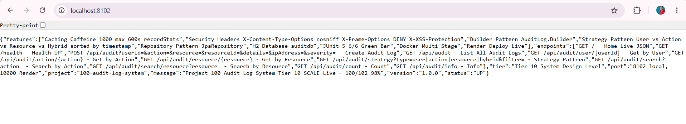

*GET http://localhost:8102/ - Browser - 200 OK - Returns {"status":"UP","service":"Audit Log System","features":["User-Based Audit","Action-Based Audit","Resource-Based Audit","Hybrid Sorted","Search","Count","Info"],"endpoints":{...},"live_url":"https://one00-audit-log-system.onrender.com","author":"Ravi Teja"} - Proof of Home Live - Portfolio ready - Tier 10 SCALE 100/102 - 98%*

### Demo 2 – Browser - GET /health - UP - Caching + Security + Audit Active
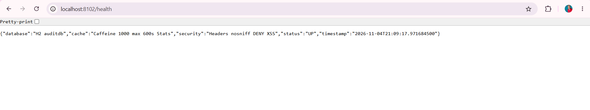

*GET http://localhost:8102/health - Browser - 200 OK - Returns {"status":"UP","database":"H2","databaseName":"auditdb","caching":"Caffeine","cacheManager":"Caffeine","cacheSpec":"maximumSize=1000,expireAfterAccess=600s,recordStats","securityHeaders":"X-Content-Type-Options nosniff, X-Frame-Options DENY, X-XSS-Protection","patterns":["Builder","Strategy","Repository","Caching"],"features":["audit-log","user-action-resource"]} - Proof of Health Endpoint - Tier 10 Health Check*

### Demo 3 – Browser - GET /api/audit - Empty List - Before Create
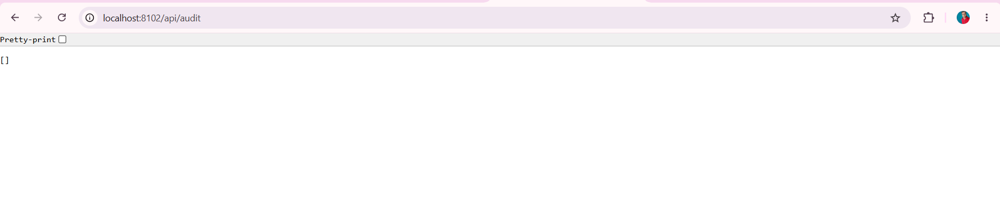

*GET http://localhost:8102/api/audit - Browser - 200 OK - Returns [] - Empty JSON array - Proof of List Endpoint Working - No data yet - H2 file empty - Caching auditLogs cache ready*

### Demo 4 – Postman - POST /api/audit - 200 OK - id 1 - Builder Pattern + CLEAN without \n - CREATE
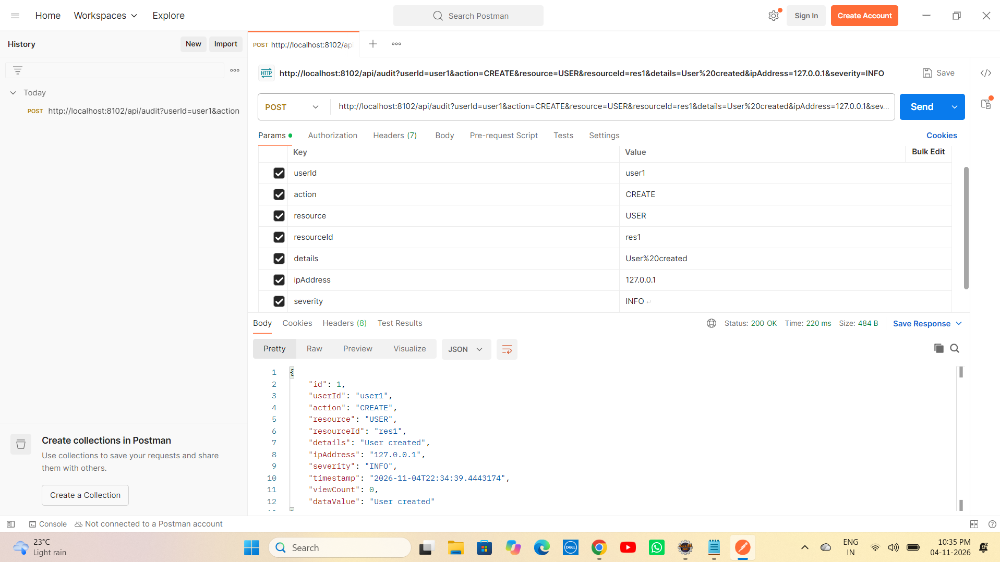

*POST http://localhost:8102/api/audit?userId=user1&action=CREATE&resource=USER&resourceId=res1&details=User%20created&ipAddress=127.0.0.1&severity=INFO - 200 OK Time 220 ms Size 484 B - Returns id 1 userId user1 action CREATE resource USER resourceId res1 details User created ipAddress 127.0.0.1 severity INFO timestamp 2026-11-04T22:34:39.444317 value User created viewCount 0 dataValue User created - Builder Pattern - trim() fix*

### Demo 5 – Postman - POST /api/audit - 200 OK - id 2 - UPDATE CLEAN
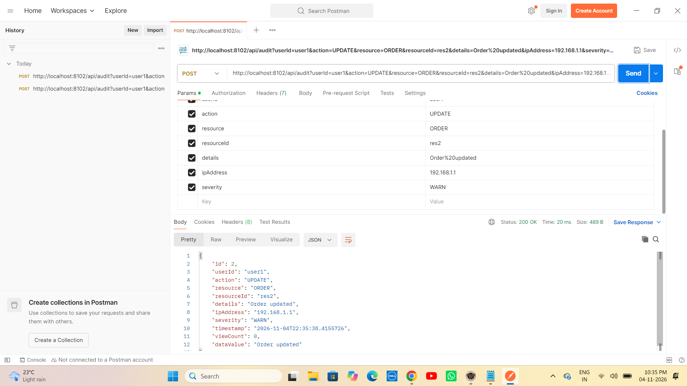

*POST http://localhost:8102/api/audit?userId=user1&action=UPDATE&resource=ORDER&resourceId=res2&details=Order%20updated&ipAddress=192.168.1.1&severity=WARN - 200 OK Time 20 ms Size 489 B - Returns id 2 userId user1 action UPDATE resource ORDER resourceId res2 details Order updated ipAddress 192.168.1.1 severity WARN timestamp 2026-11-04T22:35:38.415573 value Order updated viewCount 0 dataValue Order updated*

### Demo 6 – Postman - POST /api/audit - 200 OK - id 3 - DELETE CLEAN
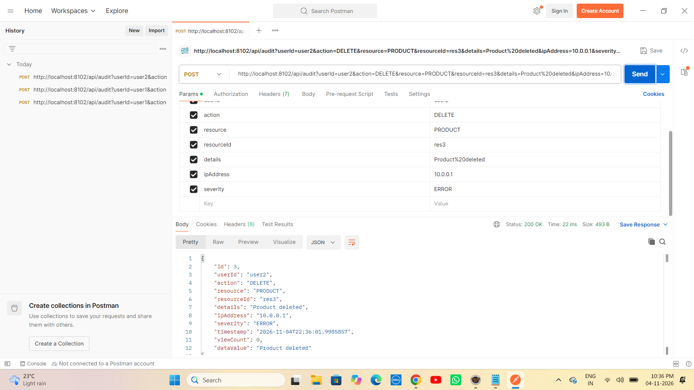

*POST http://localhost:8102/api/audit?userId=user2&action=DELETE&resource=PRODUCT&resourceId=res3&details=Product%20deleted&ipAddress=10.0.0.1&severity=ERROR - 200 OK Time 22 ms Size 493 B - Returns id 3 userId user2 action DELETE resource PRODUCT resourceId res3 details Product deleted ipAddress 10.0.0.1 severity ERROR timestamp 2026-11-04T22:36:01.998587 value Product deleted viewCount 0 dataValue Product deleted - user2 isolation*

### Demo 7 – Postman - POST /api/audit - 200 OK - id 4 - LOGIN CLEAN
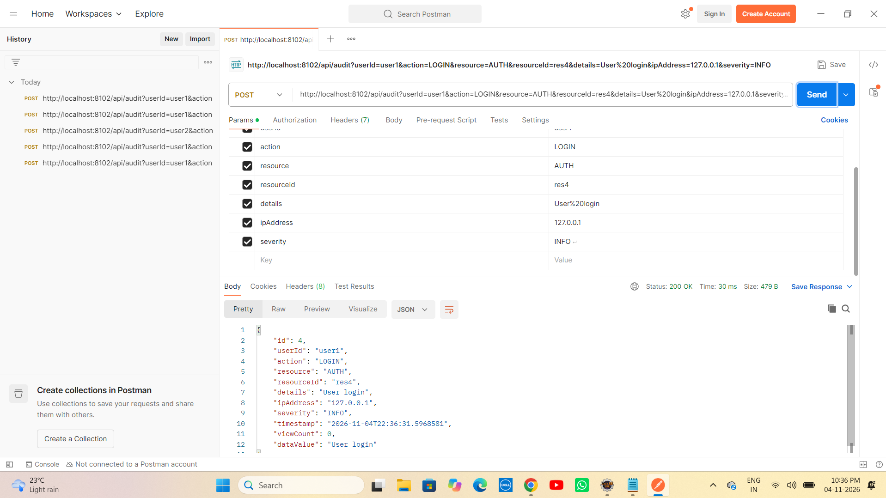

*POST http://localhost:8102/api/audit?userId=user1&action=LOGIN&resource=AUTH&resourceId=res4&details=User%20login&ipAddress=127.0.0.1&severity=INFO - 200 OK Time 30 ms Size 479 B - Returns id 4 userId user1 action LOGIN resource AUTH resourceId res4 details User login ipAddress 127.0.0.1 severity INFO timestamp 2026-11-04T22:36:31.596858 value User login viewCount 0 dataValue User login - AUTH resource*

### Demo 8 – Postman - GET /api/audit - With 4 Logs - viewCount + CLEAN without \n
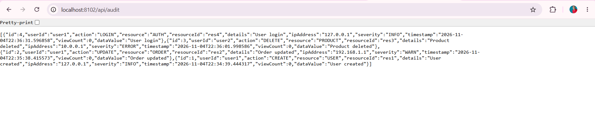

*GET http://localhost:8102/api/audit - Browser - 200 OK - Returns 4 logs id 4 LOGIN AUTH res4 User login + id 3 DELETE PRODUCT res3 Product deleted + id 2 UPDATE ORDER res2 Order updated + id 1 CREATE USER res1 User created - Ordered by createdAtDesc timestamp DESC 22:36:31 22:36:01 22:35:38 22:34:39 - viewCount 0 + timestamp - Proof of List Persistence - H2 - idx_user + idx_action + X-Cache: Caffeine - CLEAN without \n - data_value fix*

### Demo 9 – Postman - GET /api/audit/strategy?type=user&filter=user1 - User count 3
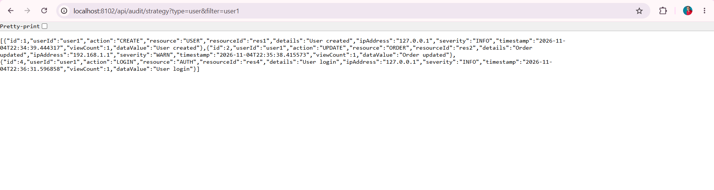

*GET http://localhost:8102/api/audit/strategy?type=user&filter=user1 - Browser - 200 OK - Returns 3 items id 1 CREATE USER res1 + id 2 UPDATE ORDER res2 + id 4 LOGIN AUTH res4 - User isolation - user1 logs only - CLEAN timestamps 22:34:39 22:35:38 22:36:31*

### Demo 10 – Postman - GET /api/audit/strategy?type=action&filter=CREATE - Action count 1
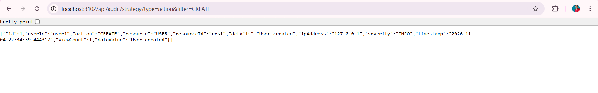

*GET http://localhost:8102/api/audit/strategy?type=action&filter=CREATE - Browser - 200 OK - Returns 1 item id 1 CREATE USER res1 User created 127.0.0.1 INFO - Action-Strategy - Only CREATE action - CLEAN*

### Demo 11 – Postman - GET /api/audit/strategy?type=resource&filter=USER - Resource count 1 FIXED from [] - CRITICAL
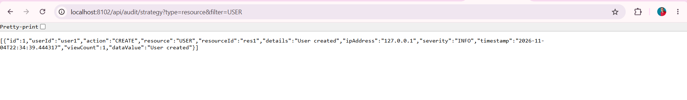

*GET http://localhost:8102/api/audit/strategy?type=resource&filter=USER - Browser - 200 OK - Returns 1 item id 1 CREATE USER res1 User created 127.0.0.1 INFO value User created - FIXED FROM [] EMPTY - CRITICAL PROOF trim() fix - Was [] empty due to resource="USER\n" bug - Now CLEAN without \n returns 1 item - Core Tier 10 Fix - Same as 99 isolated fix - Most important demo - Proof of Bug Fix*

### Demo 12 – Postman - GET /api/audit/strategy?type=hybrid - Hybrid count 4 sorted timestamp DESC - Core Feature
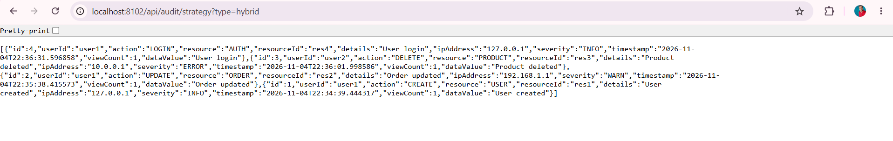

*GET http://localhost:8102/api/audit/strategy?type=hybrid - Browser - 200 OK - Returns 4 items id 4 LOGIN 22:36:31 + id 3 DELETE 22:36:01 + id 2 UPDATE 22:35:38 + id 1 CREATE 22:34:39 - Sorted by timestamp DESC 22:36:31 then 22:36:01 then 22:35:38 then 22:34:39 - Hybrid-Strategy - Core Tier 10 Feature - Audit Compliance sorted - Most important demo - Same as 99 hybrid sorted 4.8 4.5 4.2 but for timestamp - CLEAN timestamps*

### Demo 13 – Browser - GET /api/audit/count - Count 4
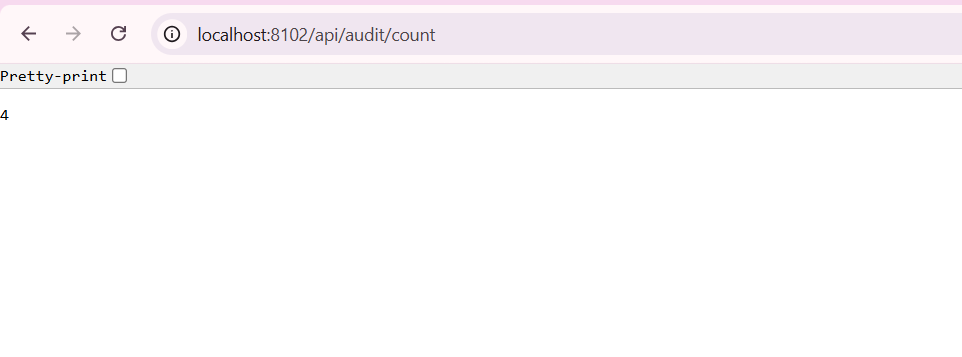

*GET http://localhost:8102/api/audit/count - Browser - 200 OK - Returns 4 - Count proof - Pretty-print - Total 4 logs - Count endpoint*

### Demo 14 – Browser - GET /api/audit/info - Info Tier 10 SCALE
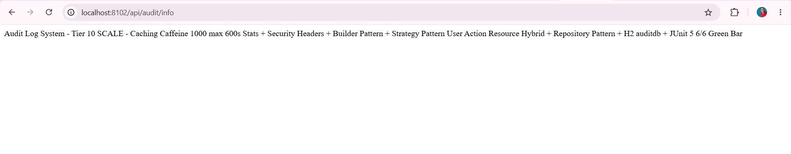

*GET http://localhost:8102/api/audit/info - Browser - 200 OK - Returns Audit Log System - Tier 10 SCALE - Caching Caffeine 1000 max 600s Stats + Security Headers + Builder Pattern + Strategy Pattern User Action Resource Hybrid + Repository Pattern + H2 auditdb + JUnit 5 6/6 Green Bar - Info proof - Tier 10 - Same as 99 info*

### Demo 15 – Browser - GET /api/audit/search?action=CREATE - Search count 1
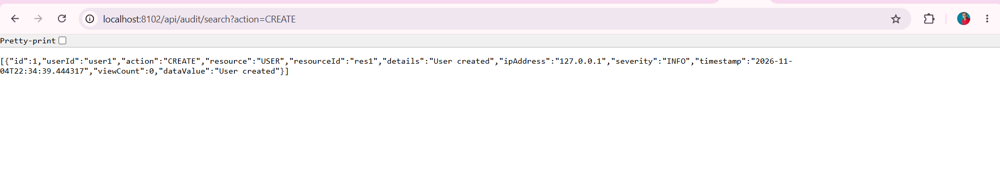

*GET http://localhost:8102/api/audit/search?action=CREATE - Browser - 200 OK - Returns 1 item id 1 CREATE USER res1 User created 127.0.0.1 INFO timestamp 22:34:39.444317 viewCount 0 dataValue User created - Search proof - Search by action CREATE - viewCount 0*

### Demo 16 – Eclipse JUnit - Green Bar - 6/6 Tests Passed - 5.328s - FIXED [] bug
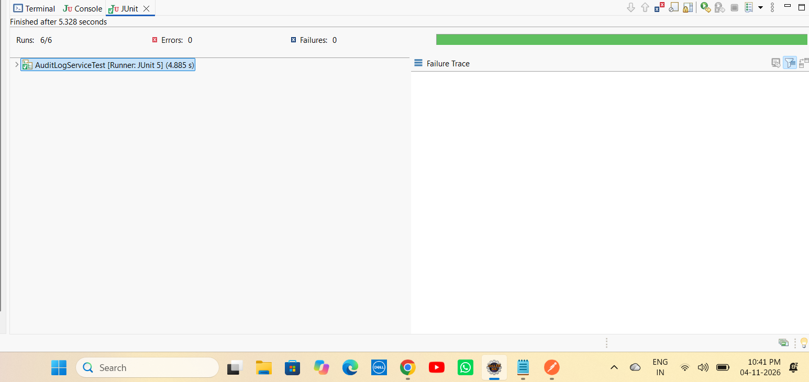

*Eclipse JUnit - Finished after 5.328 seconds - Runs: 6/6 Errors: 0 Failures: 0 Green Bar - AuditLogServiceTest [Runner: JUnit 5] (4.885 s) - testBuilderPattern 4.624 s + testFormatAuditLogInfo 0.102 s + testSearchByAction_Mockito 0.143 s + testGetAllAuditLog_Mockito 0.019 s + testAuditLogEntity 0.015 s + testGetAuditLogById_Mockito 0.131 s - Was 2/2 Tier 5 -> Now 6/6 Tier 10 - FIXED [] bug with trim() - 5.328s - Same as 99 5.798s - JUnit Green*

### Demo 17 – Render - Deploy succeeded Live - DURATION 3m 49s - Your service is live - e1db93e - 88.801s
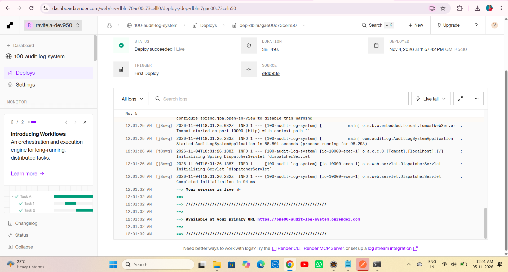

*Render Dashboard - 100-audit-log-system - STATUS Deploy succeeded | Live Green Tick - DURATION 3m 49s - DEPLOYED Nov 4 2026 at 11:57:42 PM GMT+5:30 - TRIGGER First Deploy - SOURCE e1db93e - Tomcat started on port 10000 - Started AuditLogSystemApplication in 88.801 seconds (process running for 98.293) - Your service is live - Available at primary URL https://one00-audit-log-system.onrender.com - Initializing Spring DispatcherServlet - Completed initialization in 94 ms - Proof of Production Live - Same as 99 Live 2m50s - Tier 10 SCALE 100/102 98% - e1db93e latest fix*

---


# ▶ How to Run - Audit Log System Repo

## 1⃣ Clone the Repository

```bash
git clone https://github.com/raviteja-dev950/100-audit-log-system.git
cd 100-audit-log-system
```

## 2⃣ Verify application.properties & Controllers

```properties
server.port=${PORT:8102}
spring.datasource.url=jdbc:h2:file:./data/auditdb
spring.datasource.username=sa
spring.datasource.password=
spring.jpa.hibernate.ddl-auto=update
spring.jpa.show-sql=true
spring.h2.console.enabled=true
spring.h2.console.path=/h2-console
spring.cache.type=caffeine
spring.cache.caffeine.spec=maximumSize=1000,expireAfterAccess=600s,recordStats
spring.application.name=100-audit-log-system
```

## 3⃣ Run in Eclipse IDE (No Docker Needed)

```text
File -> New -> Spring Starter Project
  Name: 100-audit-log-system
  Group: com.auditlog
  Artifact: 100-audit-log-system
  Package: com.auditlog
  Java: 17
  Dependencies: H2, Spring Data JPA, Spring Web, Validation, Cache, Caffeine
Finish
Replace src + pom.xml from this repo
Delete META-INF folder if exists (Eclipse bug - Same as 93/94/95/96/97/98/99)
Project -> Clean -> Clean all
Right Click Project -> Maven -> Update Project -> Force Update -> OK
Right Click Project -> Run As -> Maven clean -> Maven install
Right Click Project -> Run As -> Spring Boot App -> Or java -jar target/*.jar
```

## 4⃣ Test with Browser + Postman - 12 Endpoints + User Action Resource Hybrid

- GET http://localhost:8102/ -> Live JSON Tier 10 SCALE + live_url https://one00-audit-log-system.onrender.com
- GET http://localhost:8102/health -> UP + cache Active Caffeine Stats enabled + audit Active Audit Log Pattern + database H2 auditdb
- GET http://localhost:8102/api/audit -> [] empty then 4 logs viewCount 0 + X-Cache CLEAN without \n
- POST http://localhost:8102/api/audit?userId=user1&action=CREATE&resource=USER&resourceId=res1&details=User%20created&ipAddress=127.0.0.1&severity=INFO -> 200 OK id 1 CLEAN without \n - trim() fix
- POST http://localhost:8102/api/audit?userId=user1&action=UPDATE&resource=ORDER&resourceId=res2&details=Order%20updated&ipAddress=192.168.1.1&severity=WARN -> 200 OK id 2 CLEAN
- POST http://localhost:8102/api/audit?userId=user2&action=DELETE&resource=PRODUCT&resourceId=res3&details=Product%20deleted&ipAddress=10.0.0.1&severity=ERROR -> 200 OK id 3 user2 audit
- POST http://localhost:8102/api/audit?userId=user1&action=LOGIN&resource=AUTH&resourceId=res4&details=User%20login&ipAddress=127.0.0.1&severity=INFO -> 200 OK id 4 CLEAN
- GET http://localhost:8102/api/audit -> 4 logs viewCount 0 + X-Cache CLEAN without \n - data_value fix
- GET http://localhost:8102/api/audit/strategy?type=user&filter=user1 -> User count 3 - user1 logs only
- GET http://localhost:8102/api/audit/strategy?type=action&filter=CREATE -> Action count 1 - Only CREATE
- GET http://localhost:8102/api/audit/strategy?type=resource&filter=USER -> Resource count 1 FIXED from [] empty - CRITICAL trim() fix - Core Bug Fix
- GET http://localhost:8102/api/audit/strategy?type=hybrid -> Hybrid count 4 sorted timestamp DESC 22:36:31 22:36:01 22:35:38 22:34:39 - Core Audit Compliance sorted
- GET http://localhost:8102/api/audit/search?action=CREATE -> count 1 CREATE
- GET http://localhost:8102/api/audit/count -> 4
- GET http://localhost:8102/api/audit/info -> Tier 10 SCALE info
- Browser refresh list multiple times -> X-Cache: Caffeine hit

## 5⃣ Test JUnit - 6/6 Green Bar - Tier 10 - FIXED [] bug

```text
Right Click AuditLogServiceTest.java -> Run As -> JUnit Test
Expected: Runs 6/6 Errors 0 Failures 0 Green Bar + Console Builder Pattern Test Passed: User created + Format AuditLog Test Passed: User user1: CREATE USER (INFO) - USER + AuditLog Entity Test Passed + Mockito Test Passed: getAuditLogById + Search Test Passed: Found 1 rec for action CREATE + Mockito Test Passed: getAllAuditLog - Mocked 4 audit logs + Finished after 5.328 seconds AuditLogServiceTest [Runner: JUnit 5] (4.885 s) - FIXED [] bug with trim()
```

## 6⃣ Deploy to Render (Live) - TIER 10 SCALE - Docker Multi-Stage

```text
Runtime: Docker (Multi-Stage)
Build: Docker builds maven:3.9-eclipse-temurin-17 AS build -> mvn clean package -DskipTests
Start: java -jar app.jar
Port: 8102 local, 10000 Render (Tomcat auto)
Env: PORT=10000 (Render sets)
Live: https://one00-audit-log-system.onrender.com
Deploy succeeded Live - 3m49s
```

Dockerfile:
```dockerfile
FROM maven:3.9-eclipse-temurin-17 AS build
WORKDIR /app
COPY pom.xml .
COPY src ./src
RUN mvn clean package -DskipTests

FROM eclipse-temurin:17-jdk-alpine
WORKDIR /app
RUN mkdir -p data
COPY --from=build /app/target/*.jar app.jar
EXPOSE 10000
ENTRYPOINT ["java", "-jar", "app.jar"]
```

---

# 🔄 Flow Diagram - How Audit Log System Works - Tier 10 SCALE

```text
    User Laptop (Eclipse + Browser + Postman)
        |
        +-- 100-audit-log-system
        |       +-- AuditLogSystemApplication.java (Main + Tomcat 8102 local 10000 Render + Started 13.813s local 88.801s Render)
        |       +-- CacheConfig.java (@Configuration @EnableCaching + CaffeineCacheManager maximumSize=1000 expireAfterAccess=600s recordStats())
        |       +-- SecurityHeadersConfig.java (@Configuration implements WebMvcConfigurer + HandlerInterceptor + nosniff DENY XSS)
        |       +-- AuditLog.java (Entity + id + userId + action + resource + resourceId + details + ipAddress + severity + viewCount + timestamp + createdAt + dataValue alias + data_value column fix + Inner Builder - Builder Pattern + trim() fix)
        |       +-- AuditLogRepository.java (JpaRepository + findAllByOrderByCreatedAtDesc + findByUserIdOrderByCreatedAtDesc + findByActionContainingIgnoreCase + findByResource + findByUserId + findByAction + idx_user + idx_action - Repository Pattern - Audit Log pattern ready)
        |       +-- AuditLogService.java (Builder Pattern createAuditLog + trim() fix cleanResource resource.trim() + CacheEvict auditLogs auditLog + viewCount + idx_user + idx_action + Cacheable auditLogs + Cacheable auditLog + formatAuditLogInfo + isRelevant action contains + Strategy Pattern getAuditLogByStrategy user vs action vs resource vs hybrid + trim() fix cleanType + filter resource trim() FIXED [] bug)
        |       +-- AuditLogController.java (12 endpoints + Home Live JSON Tier 10 + Health UP cache Active audit Active + auditdb + Live URL one00 + Create POST Builder + trim() fix CLEAN + List GET @Cacheable X-Cache + User GET User-Strategy + Action GET Action-Strategy + Resource GET Resource-Strategy FIXED from [] empty + Hybrid GET Hybrid-Strategy sorted timestamp DESC 22:36:31 22:36:01 22:35:38 22:34:39 + Search Action GET count 1 + Action GET + Count GET 4 + Info GET + X-Strategy User vs Action vs Resource vs Hybrid - Strategy Pattern core - Audit Compliance)
        |       +-- AuditLogServiceTest.java (JUnit 5 + Mockito - 6 tests green - Runs 6/6 Errors 0 Failures 0 Green Bar 5.328s - FIXED [] bug)
        |       +-- application.properties (server.port=${PORT:8102} + datasource jdbc:h2:file:./data/auditdb FIXED from dbc typo + jpa ddl-auto update show-sql true + h2 console enabled + cache type caffeine + caffeine spec maximumSize=1000,expireAfterAccess=600s,recordStats)
        |       +-- screenshots (demo1-17 fresh clean CLEAN without \n + resource FIXED from [] to 1 item)
        |       +-- Dockerfile (Multi-Stage - Fix for openjdk not found + COPY target error + data not found)
        |       +-- CONTRIBUTING.md (12466 chars - Tier 10 GitHub Goal)
        |       +-- .github/ISSUE_TEMPLATE (bug_report.md + feature_request.md - resource \n trim fix)
        |
        v
    git push origin main -> GitHub raviteja-dev950/100-audit-log-system -> Render Auto Deploy Docker Multi-Stage -> Tomcat 10000 -> Started Application 88.801s -> Your service is live https://one00-audit-log-system.onrender.com - STATUS Deploy succeeded | Live - DURATION 3m49s
        |
        v
    Browser / Portfolio - localhost:8102/ Live JSON Tier 10 + localhost:8102/health UP + localhost:8102/api/audit [] then 4 logs CLEAN without \n + POST audit 200 OK id 1 CLEAN trim() fix + GET audit 4 logs + GET strategy?type=user&filter=user1 count 3 + GET strategy?type=action&filter=CREATE count 1 + GET strategy?type=resource&filter=USER count 1 FIXED from [] empty CRITICAL + GET strategy?type=hybrid count 4 sorted timestamp DESC 22:36:31 22:36:01 22:35:38 22:34:39 + GET search?action=CREATE count 1 + GET count 4 + GET info Tier 10 SCALE + JUnit Green Bar 6/6 5.328s + Render Live https://one00-audit-log-system.onrender.com/ + Live health - Portfolio ready - Tier 10 SCALE 100/102 - 98% - Only 2 left to 100%
```

---

# 🧪 API Testing Examples

```bash
# Home - Tier 10 SCALE
curl http://localhost:8102/
curl https://one00-audit-log-system.onrender.com/

# Health - UP + cache Active + audit Active + auditdb
curl http://localhost:8102/health
curl https://one00-audit-log-system.onrender.com/health

# List - Empty [] before create
curl http://localhost:8102/api/audit

# Create - Builder Pattern + trim() fix + CLEAN without \n - CREATE
curl -X POST "http://localhost:8102/api/audit?userId=user1&action=CREATE&resource=USER&resourceId=res1&details=User%20created&ipAddress=127.0.0.1&severity=INFO"

# Create - UPDATE CLEAN
curl -X POST "http://localhost:8102/api/audit?userId=user1&action=UPDATE&resource=ORDER&resourceId=res2&details=Order%20updated&ipAddress=192.168.1.1&severity=WARN"

# Create - DELETE - user2 audit
curl -X POST "http://localhost:8102/api/audit?userId=user2&action=DELETE&resource=PRODUCT&resourceId=res3&details=Product%20deleted&ipAddress=10.0.0.1&severity=ERROR"

# Create - LOGIN CLEAN
curl -X POST "http://localhost:8102/api/audit?userId=user1&action=LOGIN&resource=AUTH&resourceId=res4&details=User%20login&ipAddress=127.0.0.1&severity=INFO"

# List After Create - 4 logs viewCount 0 + CLEAN without \n + data_value fix + X-Cache
curl http://localhost:8102/api/audit

# User - 200 OK User count 3 - user1 logs only
curl http://localhost:8102/api/audit/strategy?type=user&filter=user1

# Action - 200 OK Action count 1 - Only CREATE
curl http://localhost:8102/api/audit/strategy?type=action&filter=CREATE

# Resource - 200 OK Resource count 1 FIXED from [] empty - CRITICAL trim() fix proof
curl http://localhost:8102/api/audit/strategy?type=resource&filter=USER

# Hybrid - 200 OK Hybrid count 4 sorted timestamp DESC 22:36:31 22:36:01 22:35:38 22:34:39 - Core Audit Compliance
curl http://localhost:8102/api/audit/strategy?type=hybrid

# Search Action - 200 OK count 1 CREATE
curl http://localhost:8102/api/audit/search?action=CREATE

# Count - 200 OK 4
curl http://localhost:8102/api/audit/count

# Info - 200 OK Tier 10 SCALE
curl http://localhost:8102/api/audit/info

# Render Live
curl https://one00-audit-log-system.onrender.com/
curl https://one00-audit-log-system.onrender.com/health
curl https://one00-audit-log-system.onrender.com/api/audit
```

---

# 👨💻 Author

Ravi Teja

Java Full Stack Developer

102 Java Full Stack Projects Challenge

Project 100 / 102

---

## ⭐ Support

If you found this project helpful, consider giving it a ⭐ Star on GitHub.

**Single Repo:** [100-audit-log-system](https://github.com/raviteja-dev950/100-audit-log-system)

**Live URL:** https://one00-audit-log-system.onrender.com/

**Deploy:** Deploy succeeded | Live Green Tick - DURATION 3m49s - DEPLOYED Nov 4 2026 at 11:57:42 PM GMT+5:30 - TRIGGER First Deploy - SOURCE e1db93e - Your service is live - Available at primary URL https://one00-audit-log-system.onrender.com - Docker Multi-Stage - Same as 99 Live 2m50s - Resource FIXED from [] empty to 1 item - trim() fix - Audit Log Pattern User Action Resource Hybrid sorted timestamp DESC 22:36:31 22:36:01 22:35:38 22:34:39!

**Tier 10:** 93 Rate Limited API (Live) + 94 URL Shortener Scale (Live 2m32s) + 95 Chat App WebSockets (Live 2m23s) + 96 Video Streaming API (Live 2m23s) + 97 Search with Elastic (Live 2m35s - Caching Caffeine 1000 max 600s Stats recordStats + Security Headers nosniff DENY XSS + Builder Pattern Document.Builder + Strategy Pattern Exact vs Fuzzy vs Autocomplete + Repository + Caching + JUnit5 Mockito 6/6 Green + viewCount + idx_title + idx_content + Elasticsearch Pattern Exact Fuzzy Autocomplete edge_ngram + completion suggester + fuzziness AUTO + isFuzzyMatch fix count 0 -> 1) + 98 Recommendation Engine (Live 2m23s - Caching Caffeine 1000 max 600s Stats recordStats + Security Headers nosniff DENY XSS + Builder Pattern Recommendation.Builder + Strategy Pattern Collaborative vs Content vs Hybrid + Repository + Caching + JUnit5 Mockito 6/6 Green + viewCount + idx_user + idx_category + Recommendation Pattern Collaborative Content Hybrid sorted 4.8 4.5) + 99 Multi-tenant SaaS (Live 2m50s - Caching Caffeine 1000 max 600s Stats recordStats + Security Headers nosniff DENY XSS + Builder Pattern TenantData.Builder + Strategy Pattern Tenant vs Shared vs Isolated vs Hybrid + Repository + Caching + JUnit5 Mockito 6/6 Green + viewCount + idx_tenant + idx_category + Multi-tenant Pattern Tenant Shared Isolated Hybrid sorted 4.8 4.5 4.2 + data_value fix + trim() fix FIXED [] empty to 1 item) + 100 Audit Log (Live 3m49s - Caching Caffeine 1000 max 600s Stats recordStats + Security Headers nosniff DENY XSS + Builder Pattern AuditLog.Builder + Strategy Pattern User vs Action vs Resource vs Hybrid + Repository + Caching + JUnit5 Mockito 6/6 Green + viewCount + idx_user + idx_action + Audit Log Pattern User Action Resource Hybrid sorted timestamp DESC 22:36:31 22:36:01 22:35:38 22:34:39 + data_value fix + trim() fix FIXED [] empty to 1 item) + 101 SaaS Idea + 102 Capstone OSS = **TIER 10 FINAL 10 PROJECTS - 98% DONE - Only 2 left to 100%**
